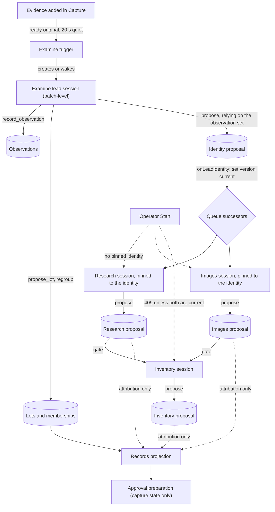
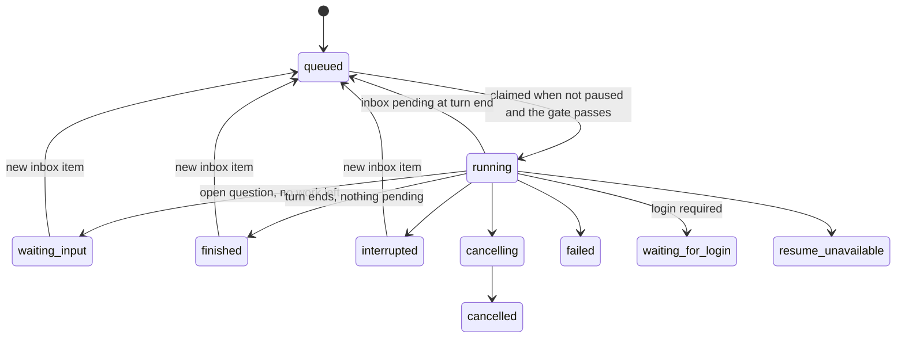
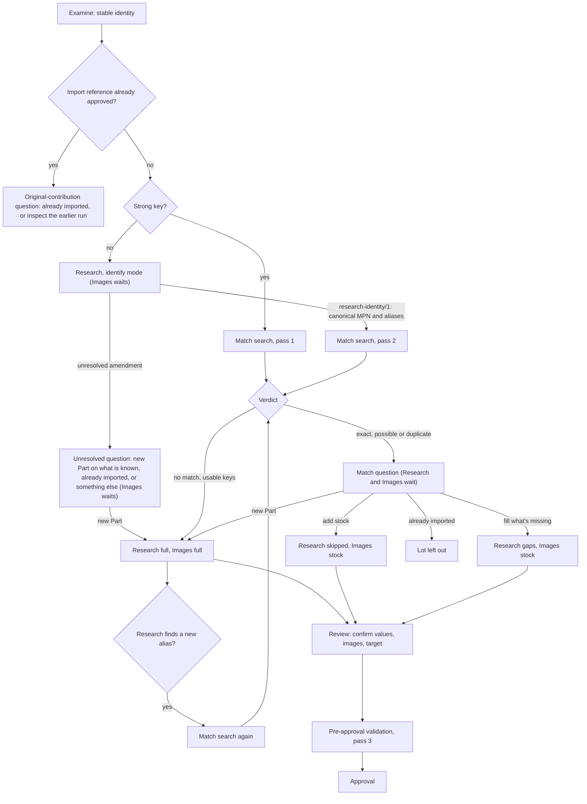
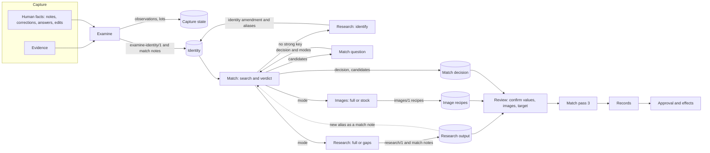

# Agent sessions: inputs, outputs and flow

This is the technical and design reference for Bench Intake's processing agents: what each agent receives, what it produces, how one agent's output reaches the next, and how operator input and new evidence re-steer them.

[Current behaviour](#part-1-current-behaviour) describes the code at `9db1921e` on `interactive-app` (2026-11-23), as read from the source. [Target design](#part-2-target-design) is a proposal, planned in the OpenSpec change `agent-stage-inputs-outputs` (BI-022). Nothing in Part 2 is implemented yet.

Paths are relative to the repository root. Line references are to `9db1921e` and will drift.

## Terms

| Term | Meaning |
| --- | --- |
| Stage | One of `examine`, `research`, `images`, `inventory` (`contracts/src/agents.ts` `AGENT_SETTINGS_STAGES`). Examine is batch-level; the others are per lot (`LOT_STAGES`, `intake-server/src/processing/session-attempts.ts:26`). |
| Job | One stage for one subject (`processing_job`): the batch for Examine, a lot for the others. A job's session lineage id is the job id. |
| Attempt | One run of a job against one sealed input (`processing_attempt`). A job's current attempt is `current_attempt_id`. |
| Session | The provider conversation for an attempt (`agent_session`), resumable across turns. |
| Profile | The sealed instruction text, digest and tool profile a session runs under (`processing_profile`; `intake-server/src/processing/session-policy.ts`). |
| Input manifest | The sealed, digested JSON an attempt is pinned to (`processing_input`; `ProcessingInputV6`, `contracts/src/processing.ts:119-205`). |
| Opening | The first user message of a fresh session, rendered from the manifest (`openingText`, `intake-server/src/agents/session/session-runner.ts:358-397`). |
| Outbox | What a session emits, in order (`agent_session_outbox`; kinds in `contracts/src/sessions.ts:75-93`). |
| Inbox | What is delivered to a session (`agent_session_inbox`; kinds in `contracts/src/sessions.ts:96-126`). |
| Proposal | A session's published claim about its subject (`processing_proposal`; `ProcessingProposalV5`). |

# Part 1: Current behaviour

## 1.1 Pipeline and dependencies

The rules behind the diagram:

- **Examine starts from evidence.** The Examine trigger sends each new ready original, after a 20 s quiet period, to the lead session as an `evidence` item, or creates the lead job (`intake-server/src/processing/examine-trigger.ts:25,40-110,155-207`). Media for Examine is originals only (`intake-server/src/media/inputs.ts:199-215`).
- **A stable identity starts Research and Images.** A lead proposal that names `identity` in `relies_on.fields` and cites `{kind: 'observation_set', lot_id, version}` at the lot's current version is stable. `onLeadIdentity` queues Research and Images pinned to it (`intake-server/src/processing/stable-identity.ts:28-38,65-161`).
  - A successor that is queued but has never run, or that is `superseded`, `cancelled` or `failed`, gets a new attempt, subject to provider availability.
  - Any other successor gets a `revision` inbox item instead (`stable-identity.ts:25,115-138`).
  - An identity citing an older version is stale at once (`lot_regrouped`).
- **Inventory is never queued by the pipeline.** Only operator Start (`intake-server/src/processing/commands.ts:38,79-107`) and session replacement queue it. Its claim waits for `successorsCurrent`: a non-stale proposal on the current attempt of both Research and Images (`stable-identity.ts:186-196`; `session-runner.ts:535-542`).
- **Operator Start can bypass the lead.** Start queues Research and Images with no pinned identity (`commands.ts:99-107`). With a session profile it sends all stages at once, and the whole request fails with 409 `inventory_waiting` if Research and Images aren't current (`frontend/src/components/processing/ProcessingWorkspace.tsx:395-401`).
- **At claim** (`session-runner.ts:462-542`):
  - a paused batch's sessions stay queued;
  - a stale pinned identity cancels a session that hasn't run a turn yet (`turnCount === 0`, `session-runner.ts:524-533`); once it has run, a revised identity reaches it as an inbox item instead;
  - Inventory waits for its gate;
  - a VM profile runs only on a worker paired to the same profile.

## 1.2 What every session receives

| Input | Source | Notes |
| --- | --- | --- |
| System prompt | The profile's `instruction_bytes`, checked against `manifest.instruction_sha256` at claim (`session-runner.ts:508-513,616`) | Same text for every stage. `shared-vm-agent/3`: `intake-server/migrations/0033_shared_vm_web_tools.sql:12-14`. It asks for URL citations, which the proposal contract can't hold. |
| Opening (fresh session) | `openingText` | JSON of `stage`, `capture_revision`, `subject_id`, `subject` (the lot record), `linked_part`, `defaults`, notes with `text_sha256` (less the automation-intent note, which `evidenceNotes` filters out: `session-runner.ts:374`, `intake-server/src/capture/context-input.ts:61-63`), evidence ids and digests, `pending_inbox`, `part_description_style`, and an `instructions` string. |
| `instructions` in the opening | `session-runner.ts:389-394` | `LEAD_INSTRUCTIONS` for Examine only, then style guidance, web guidance (profile-dependent) and one generic paragraph about status, propose, ask, inbox and the catalogue block. Research, Images and Inventory get identical text. It isn't covered by any digest, but is rendered deterministically from the sealed manifest. |
| Opening (resumed session) | `session-runner.ts:359-361` | Only "You have N new inbox item(s). Call read_inbox and continue." |
| Tools | `intake-server/src/agents/tools/server.ts:16-67` | Every session: `status`, `propose`, `ask`, `reply`, `fetch_evidence`, `read_inbox`. Examine only: `read_batch`, `record_observation`, `propose_lot`, `regroup`. VM Claude adds `Bash, Read, Write, Edit, Glob, Grep, WebSearch, WebFetch` (`session-adapters.ts:87-96`). VM Codex adds shell, view_image and live web search (`session-adapters.ts:322-335`). |
| Inbox delivery | `session-adapters.ts:51-84`; `session-runner.ts:623-656,768,783` | Polled every 500 ms in a turn and steered in. Steered items are acknowledged only when the turn finishes live; a `read_inbox` call advances the cursor at once to the caller's `after_seq`, acknowledging items the session read earlier, not the page it returns (`intake-server/src/agents/tools/inbox.ts:233-236`). Pending items at turn end re-queue the session. Each item is rendered as `Inbox item <id> (sequence N, <kind>): <payload JSON>`. |

**Sealed but never shown to the agent** (`contracts/src/processing.ts:119-140`; `session-runner.ts:367-395`):

- `observations`: the capture's InvenTree observations, filtered to `part` and `location` by both input builders: the lot input (`intake-server/src/processing/model.ts:171-177`) and the Examine input (`session-input.ts:131-134`). Category, company and template observations aren't sealed.
- `pinned_proposal_ids`.
- The media group ↔ evidence map.
- `batch_id`, `source_id`, `settings_revision`, and the raw `web` object (shown only as guidance text).

## 1.3 Per stage

### Examine (batch lead)

- **Input:** the opening above with a null subject. The manifest's notes include automation-intent, group and evidence notes, recast as `producer: 'human'` (`intake-server/src/processing/session-input.ts:94-153`); the opening leaves out the automation-intent note. `pinned_proposal_ids` is empty.
- **`read_batch`** returns `LeadBatchView` (`contracts/src/evidence-observations.ts:102-140`; `intake-server/src/capture/evidence-observations.ts:1151-1255`):
  - the revision;
  - lots with origin, `operator_edited`, `reexamine`, `estimated_quantity`, `observation_set_version`, and member and suggested observation ids;
  - Parts (id and label);
  - observations with region, `markings`, `visible_count`, status, supersedes, `lot_id`, `operator_edited` and `same_item_as`.

  It leaves out each reading's text, `source_kind` and agreement, the observation's `evidence_id`, the lot's `quantity_basis` and exclusion, and why a lot is flagged `reexamine`.
- **`fetch_evidence`** (`intake-server/src/agents/tools/handlers.ts:178-387`):
  - Examine's whole-page fetches arrive downscaled to a 768 px long edge (`LEAD_PREVIEW_LONG_EDGE`); other stages' whole pages and every region are bounded at 2576 px (`intake-server/src/agents/tools/handlers.ts:92-98,305-325`).
  - It returns pages, the evidence label and its latest note, the citable `source`, and `delivered{page,width,height,scale,region,media_type,sha256}` with the image.
  - The budget is 8 MiB per provider run, at most 1.25 MiB per image.
  - Delivered versions are tracked in worker memory (`server.ts:119-120`), so they are lost on a restart.
- **Outputs:**

  | Tool | Writes | Triggers |
  | --- | --- | --- |
  | `record_observation` | `capture_evidence_observation` and a `capture_revision`. An operator-edited row gets a `suggested` successor instead (`evidence-observations.ts:410-461`). | Outbox `observation`. Stops the trigger re-sending that version. |
  | `propose_lot` | `capture_lot` (origin `agent`), memberships, an optional draft `capture_part`, `estimated_quantity` and its basis. On an operator-edited lot it writes only suggested memberships and silently drops label, Part and estimate (`:542-554`). | `bumpObservationSet`: supersedes unstarted successors, marks relying identities stale, sends observation notices to lot sessions (`intake-server/src/processing/regroup.ts:13-67`). Outbox `lot`. |
  | `regroup` | Moves memberships, with the same rules as `propose_lot`. | Same as `propose_lot`. Outbox `regroup`. |
  | `propose` | `processing_message` and `processing_proposal` with `relies_on`. | `onLeadIdentity` when it is a stable identity. Outbox `proposal`. |
  | `ask` | `processing_question` (open) and `processing_message`. | Settles the session as `waiting_input` when no work remains. Outbox `question`. |
  | `reply`, `status` | Outbox only. | Shown in the drawer. |

- **Mismatches:**
  - The instructions say "Publish markings, identity and quantity", but `ProcessingProposalV5` has no markings or identity fields. "Identity" is whatever `summary` and `catalogue` say, with `identity` in `relies_on.fields`.
  - The generic paragraph also asks the lead for the catalogue block, overlapping Research.
  - `same_item_as` is in the instructions, but only the operator can set it.

### Research (per lot)

- **Queued by:** a stable identity, pinned to it; or operator Start, unpinned.
- **Input:**
  - the shared opening, whose subject is the lot record (label, quantity, estimate and basis, `evidence_observation_ids`);
  - the linked Part;
  - lot, Part, batch, group and evidence notes;
  - the evidence the lot uses.

  It doesn't see the identity it is pinned to, observation contents, or the catalogue vocabulary.
- **Output:** a V5 proposal. The catalogue block is expected but not enforced. An existing category, company or template choice needs an `observation_id` (`contracts/src/effects.ts:14-19`; `catalogue-assessment.ts:42,76-124`). The session is never given those ids, so in practice its values are `proposed_new` or judged unsupported.
- **Consumers:** Records attribution and the Part's "missing", "not reused" and "unsupported" lists (`contracts/src/records-projection.ts:156-230,672-746`). Inventory's gate.

### Images (per lot)

- **Queued:** exactly as Research (`SUCCESSOR_STAGES`, `intake-server/src/processing/supersede.ts:7`).
- **Input:** the same as Research.
- **Output:** a V5 proposal with no image content. No session tool creates or selects media.
  - `fetch_evidence` crops go to a private cache and "are never evidence versions" (`intake-server/src/media/region-crops.ts:12-16`).
  - Retained crops (`documentary-crop/1`, `documentary-rotated-region/1`, `contracts/src/media.ts:98-134`) come only from the operator's `derive` and `select_attachment` edits.
- **Consumers:** Inventory's gate, which any non-stale proposal satisfies, and Records' catalogue selection, which prefers current proposals (falling back to all when none is current) and ranks Part proposals before lot proposals, whatever the stage (`contracts/src/records-projection.ts:672-746`). Processing › Images (`frontend/src/components/processing/ProcessingImages.tsx`) lists Capture's originals and crops, not session output.
- **Observed (dev batch `0b02578a…`, 2026-11-22/23):** both Images attempts read the markings, counted 25 diodes, tried to research the part and published a catalogue proposal (category "Diodes", description, quantity estimate). Neither produced an image.

### Inventory (per lot)

- **Queued:** only by Start or replacement, after its gate passes. `onLeadIdentity` loops over Research and Images only (`stable-identity.ts:95`).
- **Input:** the same as Research, with `pinned_proposal_ids: []`.
  - It can't read Research or Images proposals, or cite them (`handlers.ts:747`).
  - It gets none of the lot's observation or identity notices (`intake-server/src/processing/currentness.ts:61-72`). Evidence removal still notifies the owner of any proposal citing the removed evidence, Inventory included (`currentness.ts:363-409`).
  - It has no inventory read; the profile forbids inventory access.
- **Output:** a V5 proposal. Matches, duplicates and locations have no contract.
- **Consumers:** none specific. Processing › Inventory shows record projections, and its "In InvenTree" column is always "Not known" (`frontend/src/components/processing/ProcessingInventory.tsx:140-153`).

## 1.4 From agent output to InvenTree

- **Records are capture state.** `projectRecords` builds them from capture state (`contracts/src/records-projection.ts:442-944`).
- **Proposals annotate and project records; none of their values is applied to capture state or approval:**
  - they label a field's origin step when a capture value equals a proposal value, with a parameter's alternatives (`:117-140,251-360`);
  - they add Part details (`required_missing`, `not_reused`, `category_reason`);
  - they list `unsupported` catalogue values from one catalogue per Part, chosen by preferring current proposals (falling back to all when none is current) and ranking Part proposals before lot proposals, whatever the stage (`:672-746`);
  - they add a "company proposed new" record that says creating one is not supported yet (`:750-777`).
- **Nothing applies a catalogue to a Part spec.** `applicableCatalogueSpec` (`intake-server/src/processing/catalogue.ts:20`) has no production caller. Lead-created Parts are bare rows.
- **Quantity and tags from current proposals are ignored.** The suggestions UI acts only on `bench-intake-proposal/4` (`frontend/src/components/operator/ProcessingSuggestions.tsx:44`). Stock quantity comes from the lead's `propose_lot` estimate, projected for the operator to confirm (`records-projection.ts:890-920`).
- **Approval never reads proposals** (`intake-server/src/review/approve-preparation.ts`).
  - `create_part` sends name, description, category and tags, with no image (`intake-server/src/execution/effects/effects-body.ts:68-76`).
  - A Part attachment comes only from an operator-selected media version (`effects-plan.ts:494-572`).

## 1.5 Updates and re-steering

| Event | Who is told | Channel | Staleness | Wakes |
| --- | --- | --- | --- | --- |
| New ready original | Examine lead | `evidence` inbox, after a 20 s quiet period (`examine-trigger.ts:40-110,155-171`) | None | Lead resumed or created |
| Evidence removed | Lead (batch notice); the lot's Research and Images (keyed by removal revision); the owner of any proposal citing it, Inventory included | `revision` (`currentness.ts:392-409`) | Proposals citing the version, an observation on it or its notes: `evidence_removed`, transitively | Yes |
| Evidence restored | Lead | `evidence` (`currentness.ts:418-439`) | None | Yes |
| Observation added to or removed from a lot | The lot's Research and Images | `evidence` / `revision` (`currentness.ts:169-216`) | Proposals citing a removed observation | Yes |
| Operator corrects an observation, or marks it the same item as another | Nobody | Sets `operator_edited` and the lot's `reexamine` (`evidence-observations.ts:812-873,945-992`) | None | No; the lead sees it only on its next `read_batch` |
| Operator moves, splits or merges | Research and Images through observation notices; lead only if one of its identities went stale (`currentness.ts:286-313`) | `revision` | Relying identities: `lot_regrouped` | Partly |
| Operator corrects a lot's identity or quantity | Sessions relying on the field, matched by subject | `revision` from `fieldsSuperseded` (`intake-server/src/capture/repository.ts:1388-1406`) | Relying proposals | Yes |
| Examine publishes another stable identity | The lot's Research and Images that have run and aren't superseded, cancelled or failed | `revision` with "The lot's identity was revised: ‹summary›" (`stable-identity.ts:115-135`) | None for the earlier identity; a new identity citing an older observation set is stale at once (`lot_regrouped`). Regrouping, not publication, makes relying proposals stale (`regroup.ts:13-67`). | Yes; unstarted, superseded, cancelled and failed successors get a new attempt instead |
| Answer to a session question | The asker, plus sessions relying on the fields | `answer` (asker) and `revision` (others) (`intake-server/src/processing/session-answers.ts:134-155`) | Relying proposals | Yes |
| Chat message | That session | `chat` (`intake-server/src/processing/routes.ts:128-146`) | None | Yes |
| Batch or group instruction | Every session of the batch | `instruction` (`intake-server/src/agents/instructions.ts:16-25,141-159`) | None | Yes |
| Pause or Resume | Sessions of the batch | Claim gate (`intake-server/src/agents/pause.ts`; `session-runner.ts:462-470`) | None | Resume releases queued claims |
| Start fresh (replace session) | A new attempt | `session-replacement.ts` | Old attempt's proposals superseded | New session |

`onLeadIdentity`'s identity notices never reach Inventory, and `ProcessingField` has no `inventory` field (`contracts/src/processing.ts:327`). A superseded field can still reach an Inventory proposal that relies on it, because `fieldsSuperseded` selects owners by subject and field, not stage (`currentness.ts:96-110`).

## 1.6 State mapping

| Session state | Attempt state (`session-runner.ts:68-80`) | Holds a slot |
| --- | --- | --- |
| `queued` | `queued` | No |
| `running`, `cancelling` | `running` | Yes |
| `waiting_input` | `waiting_for_user` | No |
| `finished` | `ready` | No |
| `cancelled` | `cancelled` | No |
| `interrupted`, `resume_unavailable` | `interrupted` | No |
| `failed` | `failed` | No |
| `waiting_for_login` | `waiting_for_login` | No |
| `waiting_for_capacity` | `waiting_for_capacity` | No |

A full lane leaves a claimed session `queued` (`session-runner.ts:543-545`); the runner doesn't set `waiting_for_capacity` for it. A new inbox item resumes `waiting_input`, `finished` and `interrupted` sessions (`session-runner.ts:83`; `intake-server/src/agents/session/session-execution.ts:112-145`). A running session receives it in its turn.

## 1.7 Event mapping

**Outbox (session → app)**

| Kind | Payload | Consumers |
| --- | --- | --- |
| `status` | text (at most 120 characters) | Drawer timeline, activity popover, Agents page |
| `observation` | observation id | Drawer timeline, Capture glance, Examine view |
| `lot` | lot id | Drawer timeline, Review |
| `regroup` | lot ids | Drawer timeline |
| `proposal` | proposal id | Drawer timeline (summary and sources), Records attribution, Inventory gate, stable identity |
| `question` | question id | Needs you, drawer |
| `reply` | inbox item id, text | Chat panel |

**Inbox (app → session)**

| Kind | Senders | Receivers |
| --- | --- | --- |
| `answer` | `session-answers.ts:134` | The asking session |
| `chat` | `processing/routes.ts:137` | One session |
| `evidence` | `examine-trigger.ts:157`, `currentness.ts` (observation added, evidence restored) | Lead; the lot's Research and Images |
| `instruction` | `agents/instructions.ts:114` | Every session of the batch |
| `revision` | `currentness.ts:31` (superseded fields, regroups, removals), `stable-identity.ts:120` | Relying sessions; the lot's Research and Images |

Writes publish a `processing_changed` event for the batch, which the frontend uses to re-read. `status` and `reply` publish `session_changed` instead (`handlers.ts:958,989`), and a chat item publishes `session_inbox_changed` (`agents/tools/inbox.ts:167-169`).

## 1.8 Profiles and the VM

| Profile | Tools | Status |
| --- | --- | --- |
| `shared-vm-agent/3` | Intake MCP + VM built-ins + web | Current |
| `shared-vm-agent/1`, `native-agent/2` | Intake MCP only | Allowed, not extended |
| `shared-vm-agent/2` | — | Retired (`agent_profile_retired`) |
| `synthetic-session/1` | Fixture | Tests and dev |
| `synthetic-research/2`, `native-agent/1`, `restricted-research-stub/1`, `synthetic-research/1` | Non-session handlers | Legacy. `synthetic-research/2` is still the default when `INTAKE_PROCESSING_PROFILE` is unset (`intake-server/src/config.ts:143`). |

**What a new instruction text requires** (`intake-server/migrations/0006` trigger and CHECK):

- a new profile id;
- a migration inserting its bytes and digest;
- a CHECK combination;
- a contract literal;
- a `session-policy.ts` entry;
- a `config.ts` allow-list entry.

**What admission pins** (`intake-server/src/agents/session/session-admission.ts`, `claude-session-admission.ts`):

- the CLI versions: Claude Code 2.1.319 and Codex 0.166.0;
- empty skills and slash commands, and on Claude exactly the admitted built-in plugins (with the telemetry plugin added for subscription sessions, `session-admission.ts:172-200`);
- one MCP server named `intake`, whose tool list must match exactly;
- the Codex feature set.

Tool schemas themselves aren't pinned.

**The guest container** (`tooling/deployment/bridge/tool-turn.sh:32-50`; `tooling/deployment/guest/Dockerfile:3-5`):

- `--network=none` except through the egress proxy;
- a read-only root, a 64 MB `/tmp`, 640 MB of memory;
- Python 3, Pillow, poppler, Chromium and curl; no ImageMagick.

A lineage's working directory persists between its turns. Only `fetch_evidence` images are staged into the guest; they are written to `/tmp` and removed at turn end.

## 1.9 Gaps

1. **The three lot stages are interchangeable:** same instructions, same tools, no field restriction.
2. **The hand-off is lost.** Successors are pinned to an identity they can't read, and observation readings never reach them.
3. **Existing catalogue references are out of reach**, because the vocabulary observations aren't shown.
4. **Images produces no image**, and its proposal mostly serves to satisfy Inventory's gate.
5. **Inventory is never auto-queued and can't see its inputs** or InvenTree.
6. **Operator Start bypasses the stable identity.**
7. **Web citations can't be stored**, although the instructions ask for them.
8. **Several outputs are never applied:** catalogue values, `/5` quantity and tags, supplier price, alternatives, and any Part image.
9. **Records take the first catalogue from any stage.**
10. **Operator corrections don't reach the lead**, and an identity revision is a one-line summary.
11. **Nothing prevents asking a question twice.**
12. **Quantity has two unreconciled routes:** the lot estimate and the proposal quantity.
13. **Delivered-evidence tracking lives in worker memory.**
14. **Instructions contradict the contracts:** markings and identity fields, URL sources, `same_item_as`.

# Part 2: Target design

Status: proposed. Mitch's decisions on 2026-11-23:

- Each stage gets its own typed proposal.
- Accepted values fill agent-made Parts as proposed values that the operator confirms.
- The chip logo set may be bundled.
- New work targets only the new VM profile and the synthetic fixture.
- **The Inventory agent session is replaced by an app-side Match step.** The app searches InvenTree deterministically. Examine and Research add judgement where search can't (aliases, alternate markings, logos, cross-references). The operator decides before any research or photo work is spent on an item InvenTree may already hold. A deterministic validation runs again before approval.
- **A lot waiting on its match question doesn't start Research or Images.**
- **"Add stock to an existing Part" takes a stock photo, and a Part photo only when the existing Part has none.**
- **Research and Images sessions each serve several lots**, of the same stage and mode, up to separate configurable caps.

## 2.1 Principles

1. **One contract per stage.** Each agent stage has an input brief, a tool set, an instruction pack and a typed output, each owned by that stage and checked by the server.
2. **Hand-offs are data, not prompts.** Every dependency between stages is a sealed reference plus content in the consumer's brief, and readable again with a tool. Agents never pass free text to each other.
3. **Human facts are first-class inputs.** Operator corrections, answers, notes and edits are marked as human. They are weighed first, and they reach every session that relies on them as precise changes.
4. **Deterministic work runs in the app.** Inventory search, duplicate detection, image geometry, crop rendering and logo matching are app work with provenance. Agents judge; the app computes, records and guards.
5. **Don't spend work InvenTree makes unnecessary.** A lot that matches an existing Part gets only the work the operator's decision calls for.
6. **Outputs have consumers.** Every output field is read by something named in its contract: Review, Records, approval, the Match step or a later stage. Anything else is dropped from the contract.

## 2.2 Stage contracts

### Shared brief (every session)

- **`batch`:** id, title, defaults, batch instructions, the web policy.
- **`human`:**
  - notes, each with its subject;
  - answers, with question, steps and values;
  - corrections, with the observation, the reading before and after, who and when;
  - lot edits, each with its id to cite.
- **`asked`:** questions on the subject, its Part or the batch whose fields overlap the stage's fields, with state, assumptions and answers.
- **`evidence`:** the versions the session may fetch, with labels and the regions earlier stages used.
- **`match`:** the lot's match state, its candidates with the reason each matched, and the decision and mode when one exists.
- **`revision`:** the brief's revision, which `read_lot` or `read_batch` return again.

The brief is sealed into a new input version, `bench-intake-input/7`, and rendered within a 48 KiB budget. Past the budget it is summarised. The sealed manifest stays within the retained-input cap (`MAX_PROCESSING_SNAPSHOT_BYTES`, 240 KiB, `intake-server/src/processing/limits.ts:2`). What doesn't fit goes to an immutable, bounded page store written with the input, whose page ids and digests the manifest seals; a brief beyond that bound is refused with `processing_input_capacity`, as today.

The read tools serve two views. `read_lot` and `read_batch` with the sealed revision return the rest of the brief the session started from, in pages; without it they return the current view and its revision, so an edit between queueing and the first read never mixes two revisions in one page sequence. Each page returns a continuation token bound to its revision, and a current-view read keeps that revision's pages in the attempt's bounded page store, so an edit between pages doesn't change the sequence; the page says a newer revision exists, and the session can start again without a token.

### Agent stages

| | Examine | Research | Images |
| --- | --- | --- | --- |
| Starts when | New evidence; a correction to an observation it made; an answer to its question | Match says so: **identify** mode when the lot has no searchable identifier; **full** or **gaps** mode after a decision or a clean search | Match says so: **full** or **stock** mode, after a decision or a clean search |
| Brief adds | Every observation with readings, source and confidence; lots with exclusion and `reexamine` reasons; match candidates for its lots | Pinned identity with its id; the lot's observations; the catalogue vocabulary; its mode and, for gaps, the fields to fill; the matched Part's current data | The lot's observations with regions and orientation; items to keep out of frame; its mode; whether the matched Part has an image |
| Tools | as today + `read_batch` (full readings), `inspect_region`, `match_logo`, `read_guide` | `read_lot`, `read_vocabulary`, `fetch_evidence`, `match_logo`, `read_guide`, web (VM) | `read_lot`, `fetch_evidence`, `inspect_region`, `preview_images`, `propose_images`, `read_guide` |
| Typed output | `examine-identity/1`: markings verbatim per observation; ranked identity candidates; maker or logo id with method; packaging and seal state; date code; condition; NOS signals; visible NSN; quantity estimate and basis (the only quantity route: `/7` `propose_lot` refuses its estimate arguments); **match notes** | `research-identity/1` (identify mode, and in any later mode to refine the identity): canonical MPN, manufacturer, every alias with its kind and source, cross-references, **match notes**. `research/1`: category, name, type, MPN, manufacturer, description, parameters with sources and pages, datasheet and pages, web sources (agent-reported), notes by record, conflicts, config gaps, **match notes** (gaps mode fills only the named fields) | `images/1`: image recipes with role (Part image, stock image, extra), source version, region, rotation, straightening, bounded light adjustments and flags (stock mode: stock images, plus the Part image only when the matched Part has none) |
| May not propose | research or image fields | quantity, images or match decisions | anything except images |
| Consumers | Match (search keys), Research and Images briefs, Review lots, Records | Match (search keys), Records Part spec (proposed values), Review | Review image choice, approval (Part image, stock attachments) |

**Match notes** are an agent's judgement about existing records, kept apart from the search:

- an alias: "house number 1N4148-TK is this Part's alternate marking";
- a relation: "same MPN as stock #1712, but date code 2407 vs 2341";
- a negative: "different maker's logo: not the same Part".

They add search keys, and they are quoted in the match question.

The server refuses a proposal whose kind doesn't match the session's stage or mode, or which carries fields the stage may not propose.

### The Match step (app, not an agent)

**Search keys**

- **Strong keys:** an MPN or type with a manufacturer, an NSN, an InvenTree IPN or SKU read from a label, or a candidate Part's stock with the label's batch code; a label barcode counts through the keys it decodes to. The lot's generated import reference is looked up separately, before identify mode, for duplicates only, and isn't a strong key.
- **Weak keys:** house numbers, packaging or distributor codes, generic descriptions and partial markings.
- **A lot is searchable** when it has at least one strong key.

**What it searches**

- InvenTree Parts (name, IPN, keywords), manufacturer Parts (MPN), supplier Parts (SKU) and a candidate Part's stock by batch code. The import reference is checked separately against this app's retained approvals, not searched remotely. Searches are read-only, using the app's read token. Today the target transport allows only fixed semantic reads and two list reads (`intake-server/src/inventory/transport.ts:44`), so the change adds bounded Match list reads with named filters only: Part search, manufacturer and supplier Parts, stock, and a Part's parameters and attachments. The pinned InvenTree 1.5.0 stock list has no barcode filter, so the generated import reference (`bi1:<source>:<contribution>`, `intake-server/src/execution/plan.ts:56-60`) is looked up in this app's retained approvals of that original contribution (`intake-server/src/execution/source.ts:94-110` finds them by contribution key whatever the stock outcome), which decide the hit; a stock read by PK only reports the status of any known output, so approved but uncreated, uncertain and deleted stock are hits too. A hit is an original-contribution hit: approval already refuses that contribution (`intake-server/src/review/authority.ts:92-100`), so its question offers only already imported or inspecting the earlier run, and no stage runs for the lot. The category's key parameters come from a `list_category_parameters` read by category PK, so a mapped parameter with no value row on the Part still shows as missing. InvenTree 1.5.0 returns ancestor mappings by default and doesn't filter when the category lookup fails, so Match keeps only mappings of the Part's category and its ancestors, and reports the parameters unavailable when the category can't be read.
- This app's other unapproved lots with the same keys, to detect a competing lot before two batches both create one Part. This is detection, not a uniqueness guarantee across batches.

**What it records**

- **Candidates:** each with the keys that matched and the strength of the match.
- **A verdict:** `no_match`, `exact` (a strong key and manufacturer agree), `possible` (a weak key, or a partial agreement), or `duplicate` (the same generated import reference, or the candidate Part's stock with the same batch code).

**Ordering.** A search reads InvenTree, so it never runs inside the proposal or answer transaction that triggers it. Searches run in the API process, which owns the target-bound reader and the contribution history; the session worker only commits search requests. A durable sweep there picks up committed, unsettled requests after a restart. The trigger commits a search request with the next per-lot search generation, naming the identity revision and the keys searched. The search runs after commit, and its result settles in a new transaction only if its generation is still the lot's latest; an older result is discarded, so two searches on the same identity can't settle out of order. A settled generation also supersedes any match question from an older one. The verdict, any match question or decision, and the stage queueing commit together. The generation advances when the request commits, so while a newer search is pending, answers to the older question are refused and approval waits. Batch answers follow the same rule. Pass 3 doesn't advance this generation or supersede a question: it records its own validation result, bound to the lot's current interactive generation, and runs only when that outcome is settled.

**Sufficiency check.** For a candidate Part, the app reads what InvenTree holds: datasheet, the category's key parameters, Part image, manufacturer Part, and supplier Part for this supplier. It lists what is missing. Only the datasheet, key parameters and Part image are fillable, and they decide whether "fill what's missing" is offered and which fields gaps mode fills. A missing manufacturer or supplier Part is shown for information; filling those on an existing Part needs related-record effects this change doesn't add.

### The lot's path through Match

1. **Pass 1, after Examine.** When a lot's identity becomes stable and it has a strong key, Match searches.
   - With no match, Research (full) and Images (full) are queued.
   - With candidates, the match question is asked, and Research and Images wait.
2. **Identify first, when there's no strong key.** Items packaged under a less useful identifier, or known by a different name for a Part that already exists, can't be matched until Research has identified them.
   - Research is queued in **identify** mode, and Images waits.
   - Research resolves the canonical MPN, the manufacturer and every alias: house numbers, packaging codes, cross-references and alternate markings. It publishes `research-identity/1` and pauses.
   - Match then searches with every alias (pass 2).
   - With no match, the same Research session receives its mode (full) by inbox and continues, and Images is queued.
   - If Research can't find a strong key, it publishes the amendment marked unresolved, and Match asks the operator: new Part on what is known, already imported, or something else. Images waits for the answer.
   - With candidates, the match question is asked, and the paused lot receives the decision's mode, or its membership is closed if the decision skips research; its identity amendment stays, and the session closes only when none of its lots needs it.
3. **The match question.** It is an app question on the lot, using the stepped-question form from BI-019. It is listed in Needs you, and it quotes the candidates, their reasons, the agents' match notes and what the Part is missing. Options depend on the verdict: add stock to the Part, add stock and fill what's missing (only when a fillable field is missing), new Part, already imported (leave the lot out), or something else. Several lots with exact matches can be offered as one batch-level question, with exceptions listed.
4. **Modes.** Each answer sets the stage modes, which are sealed into the brief or delivered to a paused session:

   | Answer | Research | Images |
   | --- | --- | --- |
   | New Part | full | full |
   | Fill what's missing | gaps (named fields only) | stock, plus a Part image if the Part has none |
   | Add stock | skipped | stock, plus a Part image if the Part has none |
   | Already imported | skipped; lot left out | skipped |

5. **Late matches.** If Research in full mode finds an alias or cross-reference that makes the lot searchable in a new way, it publishes it as a match note. Match searches again. A new candidate pauses Research for that lot and asks the question, as in pass 2; the session's other lots continue.
6. **Pass 3, before approval.** Before Changes › Ready, Match searches again, as preparation target reads, with each selected `/7` lot's final identifiers and import references. It looks for a Part created in InvenTree since the decision, an approval of the lot's original contribution in this app's retained history, stock on the target Part with its batch code that the decision didn't already cover, and a final identity that no longer matches its decision. Each finding is a blocking item in Review. Approval's own idempotency covers only the preparation command and its retained plan and review bindings (`intake-server/src/review/approve-preparation.ts:64-75`); it doesn't make the barcode or import reference unique in InvenTree. So a preparation records each lot's pass-3 search generation, and approval refuses it when a newer search has been requested, settled or not, or the validation read failed.

### One identity, refined by more than one stage

A lot has one current **identity**, built in layers. Examine publishes the base (`examine-identity/1`). Research, in identify mode or later, publishes an **amendment** (`research-identity/1`) that adds to it or refines it. The lot's identity is the merge, and every field records which stage, proposal and source it came from. Agents never edit capture state directly; they propose, and the merge is the app's.

**What an amendment may do**

| Change | Example | Applied |
| --- | --- | --- |
| Add an identifier | MPN `1N4148W-7-F` and manufacturer Diodes Inc. for a reel labelled only `TK-1N4148` | Automatically, as a proposed value |
| Add an alias | House number `TK-1N4148` → kind `house_number`, alias of the MPN | Automatically |
| Refine a field | Manufacturer "Diodes" → "Diodes Incorporated", with a datasheet source | Automatically, as a proposed value |
| Replace Examine's identity | Examine's top candidate 1N4148; Research shows the markings decode to 1N914 | Not applied silently. Both identities are shown, Examine is told by `revision/2`, and the lot's match question (or an ask) settles it. |
| Change a human value | The operator corrected the marking or chose the MPN | Never. Research can only ask, citing the conflict. |

**What changes when an amendment lands**

- **The lot's key details:** the lot's proposed label and its draft Part are updated, when the lot is agent-made and the operator hasn't edited them, for example "Reel TK-1N4148" becomes "1N4148W-7-F diodes (TK-1N4148)". On an edited lot they become suggestions the operator accepts in Review. Today's edited-lot suggestions cover observation membership only (`capture/evidence-observations.ts:541-555`), so task 4 adds label and draft Part suggestions.
- **Pins:** successors pin to the merged identity's revision, not to Examine's proposal alone. Images and a later Research session start from the refined identity.
- **Match:** Match searches with the merged keys: pass 2, or a late match.
- **Examine:** Examine receives a `revision/2` naming the added and refined fields. Its later identity proposals build on them instead of reverting them.
- **Review:** each refined field shows its origin ("from Research: MPN `1N4148W-7-F`, datasheet p.1"), and the operator confirms it like any proposed value.

**Not part of Match:**

- **Locations:** proposed by the app from batch defaults and the matched Part's existing stock locations, and confirmed in Review.
- **Tags:** NOS, unidentified, `nsn:` and the like, derived by rule from Examine's facts and Research's confirmation, and confirmed in Review.

## 2.3 Target hand-off graph

## 2.4 Target re-steering

Every change is delivered as a `revision/2` item carrying `changes`: `{field, from, to}`, `{observation_id, reading_from, reading_to}`, `{proposal_id, kind}` or `{match, from, to}`. Each item also carries `source` (`operator`, a session or `match`) and the new brief revision.

| Event | Examine | Match (app) | Research | Images |
| --- | --- | --- | --- | --- |
| New evidence | `evidence` + resume | — | after Examine assigns it: `evidence` | after Examine assigns it: `evidence` |
| Observation corrected by the operator | `revision/2` + resume | Re-search if a key changed | `revision/2`; relying proposals stale. If the identity changes, a claimed lot is released and requeued through Match, and its group gets a release `revision/2` | same as Research |
| Identity revised by Examine | — | Re-search; a changed verdict reopens the question | A claimed lot is released and requeued through Match; its group gets a release `revision/2` | same as Research |
| Research publishes an identity amendment | `revision/2` naming the added and refined fields | Merges the identity; searches (pass 2, or a late match) | The amending session keeps the lot; pauses if a question is asked | An unclaimed lot pins the merged identity; a lot in a claimed Images group is released and requeued, and that session gets `revision/2` |
| Research adds an alias as a match note, identity unchanged | — | Searches (a late match) | Keeps the lot; that lot pauses if a candidate opens a question | A claimed Images lot keeps its membership; a candidate holds only that lot until the decision |
| Match decision | — | Records the decision | Mode delivered to the lot, or the lot's membership closed if skipped; the session closes only when none of its lots needs it | Queued in its mode, or skipped |
| Answer to an agent's question | asker: `answer`; relying sessions: `revision/2` | Re-search if keys changed | `revision/2`; if the answer changes the identity, a claimed lot is released and requeued through Match, with a release `revision/2` to its group | same as Research |
| InvenTree changes before approval | — | Pass 3 finding, blocks approval | — | — |
| Duplicate ask | `ask` returns the existing question | — | same | same |

## 2.5 State and queueing changes

**Lot match states:**

| State | Meaning |
| --- | --- |
| `awaiting_identity` | No stable identity yet |
| `identifying` | No strong key; Research is in identify mode |
| `searching` | A search is running (passes 1–3) |
| `needs_decision` | A match question is open; Research and Images wait |
| `decided` | With the decision and modes; or `clear` after a no-match verdict. Both are a persisted Match outcome with its generation and modes, which `research/1` and `images/1` pin |
| `revalidate_blocked` | Pass 3 found a problem |

**Queueing:**

- **The Inventory stage and its gate are removed.** Successors are queued by Match, not by the stable identity alone.
- **Start pins the identity.** Operator Start pins Research and Images to the lot's current identity. It refuses lots without one ("Examine hasn't identified this lot yet") and respects the lot's match state.
- **Match waits are persisted, not inferred from the session state.** Today `waiting_input` holds only while the job has an open question of its own (`session-runner.ts:770-790`), and any unread inbox item resumes it (`session-execution.ts:112-145`). So `processing_match` records which of the lot's stages wait for Match. Claim, resume, Start and replacement all check it: a waiting stage stays parked, holding no slot, and unrelated inbox items stay pending until the wait ends. The decision's mode arrives as a `match` inbox item, which ends the wait and wakes the session.
- **Continuing after the decision.** A `match` item's mode applies when its delivery is acknowledged. When it unlocks unfinished work, the same commit persists a continuation for the session, whatever else is pending (a held peer's chat can't wake it), dispatched once the active turn settles, so it continues under the new mode without another message.
- **Resuming on a changed identity.** A resumed session keeps its sealed brief, so the `match` item that ends a wait names the merged identity revision and the mode. Its later proposals rely on that revision. If the identity changes again before the session resumes, Match searches again and the wait continues.
- **Late candidates.** A late candidate sets the lot's waits. Its queued lot jobs stay unclaimed. A running session gets a `match` item for that lot telling it to stop work on the lot at the end of its turn; only that lot's membership is held, and the session keeps working on its other lots, parking only when every lot it holds waits or is done. Proposals already published under the old mode stay retained, and are marked stale when the decision changes the mode.
- **Durable delivery tracking.** Fetches are recorded in the outbox as `photo_view` items (shared with `improve-agent-interaction`). A `photo_view` records a fetch prepared for response, which may have been withheld or lost, so it alone isn't proof of delivery. So the component that hands the image to the provider records its release: the VM relay after the image-bearing response write, and the synthetic driver after inspecting the result; direct native sessions don't run `/7`, so they record none. The release is an outbox item bound to the attempt and the view. The synthetic driver records it after inspecting a successful MCP result that carries the image; on the VM path the guest acknowledges only after the image-bearing response is written, and the coordinator records release on that acknowledgement, correlated by the forwarded request id. The relay holds the guest's next tool request until the release has committed, for a bounded time; an acknowledgement that never arrives leaves the view unreleased and the turn running. A citation is admitted only for a released view on the session's current attempt; a missing or uncertain release isn't admitted, and the session can fetch again. Tests cover a withheld reply, staging that fails after the view is committed, and a view from an older attempt.

### Multi-lot sessions

Research and Images sessions each serve several lots. Mitch decided this on 2026-11-23, with separate caps per stage.

- **Jobs stay per lot.** Each lot keeps its own job, with its state, modes, Match decision and waits, staleness and questions. A session's attempt binds 1 to N lot jobs of the same stage and the same mode: a **lot group**. Each lot job points at the attempt that holds it. The group's session lineage has its own id; a one-lot session behaves as today.
- **Grouping at claim.** A `/7` lot job is queued as an unclaimed lot with no attempt. Under a per-batch-and-stage lock, a claim takes up to the cap of unclaimed lot jobs of one stage and mode in the batch, oldest first, whose Match allows them (no wait, current search generation). A lot that is superseded or stale before the claim isn't taken. The group is sealed into the session input. A lot that becomes ready later goes to a new session; it never joins a running one, so inputs stay sealed. The claim stops adding lots before the group's media would pass the media input limits, and seals the input, overflow pages, media pins, attempt, session and memberships in one transaction.
- **Caps.** Two agent settings in Settings › Agents › Sessions: **Lots per Research session** and **Lots per Images session**, each an integer from 1 to 20, defaulting to 5 and 8. They are sealed into each attempt like the other agent settings. A cap of 1 reproduces today's one-lot sessions.
- **Brief.** The shared brief is followed by one section per lot: identity, observations, human facts, asked questions, evidence, and match state and mode. Each lot gets an equal share of the budget; the rest goes to the input's page store. `read_lot(lot_id)` returns any lot in the session's group and refuses others.
- **Outputs.** Every typed proposal names its lot: `subject_id` must be one of the group's lots. Citation release records stay per attempt, but a citation also needs the cited evidence to be in the proposal lot's scope and the lot to be an active member.
- **Claim-time mode.** A group's stage and mode are fixed at claim; a lot's mode can then change inside the group, as when an identify lot's decision gives it full mode or closes it.
- **Unclaimed lots and the anchor.** An unclaimed lot job has no attempt until claim; the claim loop scans unclaimed jobs durably, and Processing shows them as waiting for a session. The group's lineage and attempt, not its first lot's job, decide session liveness, resume, recovery and settlement, so releasing that lot or starting it fresh doesn't end or hide the session. Start and Start fresh answer with a receipt that may name no attempt yet, and a retried command returns the same receipt before and after the claim.
- **Per-lot inbox.** Lot items carry their lot, are delivered in sequence order per lot (a `match` item never ahead of that lot's earlier items), and are acknowledged per lot, only through the contiguous prefix the provider accepted, because today's single high-water cursor would consume a held lot's items. Unread items of lots that aren't held wake the session, and so does a current `match` item that ends a held lot's wait, and a released lot's pending items move with it.
- **Per-lot waits.** In identify mode, Research pauses per lot. A lot's match question or Match wait doesn't block the session's other lots: the session keeps working on the rest, and resumes that lot when its `match` item arrives. The session is parked, holding no slot, only when every lot it holds waits or is done.
- **Re-steering.** Revisions, `match` items and answers for a lot are routed to the session holding it. A lot whose identity is changed after the claim by anyone but the group's own session (Examine, the operator, a regroup or another session) is released from the group, because a successor's currentness includes its pinned identity revision: its partial work is marked stale, it is requeued as its own job, and the session is told by `revision/2`.
- **Failure and Start fresh.** A session failure marks each of its incomplete lots for retry individually: each is requeued, not the whole batch. Start fresh on one lot moves it to a new session.
- **Slots.** A session holds one slot, whatever its lot count.
- **UI.** Session rows and pages show the lots they serve ("Research · 3 lots: …"); each lot's status still comes from its lot job. BI-019's session rows and drawer assume one subject per session; BI-022's PRs adapt those surfaces after BI-019 PR-G's session-level read, and #243 isn't changed.

**App-owned questions.** Today every question belongs to an agent attempt: `processing_question` requires a job, attempt, input and message (`intake-server/migrations/0006_processing.sql:81-100`), its answer requires a continuation attempt, and the read joins all of them (`intake-server/src/processing/read.ts:248-262`). The match question exists before any Research or Images job, so it gets its own store: `processing_match_question` and its answer, pinned to the lot's match revision and the candidate set it quotes, with an answer route that records the decision. Needs you reads both stores. An answer to a question that a later search made stale is refused, and the new question is shown. The Processing tab's fourth step becomes **Match**, showing matched, waiting-for-you and new counts. The activity popover's fourth row in BI-019 is built on step counts, so it carries over.

## 2.6 MCP tools ported from the skills

The skills' deterministic scripts become intake MCP tools, run by the app on the retained originals. Both providers already reach the intake MCP server, and admission compares its tool names exactly, so each tool is part of the new profile's sealed tool profile.

| Tool | Ported from | Does | Returns |
| --- | --- | --- | --- |
| `inspect_region` | `image-grid-overlay/grid.py` | A labelled source-pixel grid over a page or region, with optional object and box overlays and centring and clipping checks | Image + margin text |
| `preview_images` | `component-photo-crops/crop.py` and `montage.py` | Renders proposed recipes (region, rotation, straightening, bounded light adjustments) from the original, with a labelled montage | Montage image + per-crop size, aspect and flags |
| `propose_images` | The cropper agent's report | Publishes `images/1` | Proposal id |
| `match_logo` | `chip-logo-identification/match.py` and `straighten.py` | Ranks the logo set against a region and returns the candidate sheet | Ranked ids, scores, sheet image |
| `read_guide` | The skills' instruction text | Returns a named section of the stage's guide, such as cropping rules, logo look-alikes or research traps | Text, sealed with the profile |
| `read_lot`, `read_vocabulary` | New | Read the lot brief or the catalogue vocabulary | Structured JSON |

**No agent search tool.** Inventory search is the Match step's, not an agent tool. Agents see candidates in their brief, and add keys through match notes, so every search is recorded and repeatable.

**Why MCP tools rather than scripts in the VM:**

- they work for both providers and both `/7` profiles;
- they operate on full-resolution originals without spending the image budget on transfers;
- their results are reproducible and recorded;
- the decoder owns the image code and the logo set, so the VM runner image gains no scripts or assets; it is still rebuilt in task 11 for the extended relay, and the coordinator's deployment gains the decoder dispatcher socket;
- recipes stay the only route to a retained crop.

**Where they run.** In the media decoder, which already owns orientation, crops and renditions. The decoder is TypeScript on `sharp` and `@napi-rs/canvas`, so the Python scripts are reimplemented there rather than called, and the geometric operations are tested for parity with the scripts' outputs. The logo set is bundled read-only with the decoder image.

**Delivery.** Tool replies with images use the same size limits as `fetch_evidence`. On the VM relay only `fetch_evidence` gets the larger image envelope today (`intake-server/src/agents/shared-vm/evidence-request.ts`), and only its replies are staged into the guest, so the relay is extended to `inspect_region`, `preview_images` and `match_logo` with one aggregate per-run image budget. Montages and logo sheets are tested over the real relay.

**Parity.** Parity with the scripts is checked on the rendered crop pixels, before labels, downscaling or delivery encoding, for crop, quarter turns and straightening. The light adjustments are hue-preserving versions of their own, tested for hue retention on coloured-pixel and colour-cast fixtures rather than for parity.

**Not in the VM.** The runner image doesn't carry the scripts today (`tooling/deployment/guest/Dockerfile`), and they aren't added.

**Instruction text.** The skills' text is split. Each stage's system prompt carries the short rules: scope, never invent, precedence and the output contract. `read_guide` holds the long reference material on demand. MCP resources can't be used for this, because admission refuses an intake server that exposes resources.

## 2.7 Instruction packs and profile

- **A new profile.** `shared-vm-agent/4` has shared base instructions in its profile row and one instruction pack per stage in an immutable `processing_stage_instructions` table, whose digest the input seals and the claim checks, as the change's design decides. Its tool profile is `native-session-stage-tools/1`. `synthetic-session/1` keeps its profile row and `native-session-tools/1` for `/6`; for `/7` it gets fixture stage packs in the same table, and its `/7` inputs seal those packs and `native-session-stage-tools/1`.
- **Each pack:**
  - the stage's scope and what it may not do;
  - never inventing (from `inventree-stock-import`);
  - the precedence (human facts, then the evidence as read, then earlier stages' readings, then web sources);
  - conflicts asked once;
  - no re-asking;
  - match notes;
  - the output contract for each mode.
- **Ported content per stage:**
  - **Examine:** transcription, NOS, packaging and seal reading from `inventree-stock-import`; grid use from `image-grid-overlay`; logo identification and look-alikes from `chip-logo-identification`; the "same Part?" evidence rules, as match notes.
  - **Research:** `component-researcher` and `COMPONENT_RESEARCH.md`, including the identify mode (aliases, NSN and CAGE, cross-references) and the gaps mode.
  - **Images:** `component-image-cropper` and `component-photo-crops`, with the stock mode.
  - **The Match step's rules** (not an agent): the existing-records check from `inventree-stock-import`, as deterministic search and the question's options.
- **Not ported:**
  - company logos;
  - source snapshots (pending an app-side fetch with receipts);
  - browser automation, the dry run, consent and the write, which are already app UI.

## 2.8 Outputs into records and approval

- **Research and Examine:** the merged identity updates an agent-made lot's proposed label and draft Part. Accepted values fill an agent-made Part's spec as proposed values that the operator confirms in Review. They never overwrite operator values. In gaps mode they fill only the existing Part's missing fields.
- **Records** take each field from the stage that owns it.
- **Images:** a confirmed recipe becomes a retained derived version, through the existing crop pipeline extended with straightening and light adjustments. It is selected as the Part image or a stock attachment. A Part image effect, gated by the target's capability, sets it on the created Part or on an existing Part that has none, and effects attach stock images.
- **Match:** the decision sets the lot's target: a new Part, an existing Part with new stock, or left out as a duplicate. Gaps mode produces update effects for the existing Part's missing fields. Pass 3 findings block approval. An add-stock or fill lot also needs a confirmed stock image, and a confirmed Part image only when the Part has none, before preparation can include it.
- **New execution authority.** Today `create_part` is a JSON create with no image (`intake-server/src/execution/effects/effects-body.ts:68-76`), and the inventory transport has no Part update (`intake-server/src/inventory/transport.ts`). The Part image on a created or existing Part, and the gaps fill, are new effect kinds in a new plan version, each gated by the target's declared capability. A gaps fill, and a Part image on an existing Part, carry the value they expect to be missing; the executor re-reads it just before writing and refuses the effect as a conflict when it is no longer empty. InvenTree has no conditional update, so a write between that read and the write can still be overwritten. Mitch accepted this narrow window on 2026-11-23; it is documented, and the effects stay enabled. Retained plans of the earlier version still execute. Uncertain effects follow the existing no-blind-replay rules.

## 2.9 Legacy

- **The new contracts apply only to** `shared-vm-agent/4` and `synthetic-session/1`. Earlier profiles stay readable for retained attempts, but are not extended. Retained Inventory attempts remain readable.
- **Cutover.** An actor's supervisor runs one profile at a time (`intake-server/src/agents/worker.ts`), so `/3` work is drained before the actor switches to `/4`; pausing isn't enough, because paused attempts stay queued for a `/3` worker. A drain fence first stops every boundary that creates or requeues a `/3` attempt, while running turns finish and leave their pending items; the drain ends when no `/3` attempt is running or queued and claimable and the actor's lane and slots are free, including the slot of a cancelled attempt whose reap isn't yet confirmed, and only then does the actor switch. The drain runs on the new build configured for `/3`, because an older worker refuses the migrated database and can't enforce the fence; the actor then switches to `/4`. Queued work that can't run, such as a paused batch's or a gated Inventory attempt, is parked for the upgrade action. The upgrade action carries waiting and parked leads, with their answers and pending items, into `/7`, and reissues their open questions on the new attempt so they stay answerable. The new behaviour is keyed on the sealed input version, `/7`, so retained `synthetic-session/1` `/6` inputs keep today's behaviour. New evidence goes to a batch's existing Examine lineage whatever its profile (`intake-server/src/processing/examine-trigger.ts:143-171`), so a batch whose lead was sealed under an earlier profile shows that, and an upgrade action replaces the lead with a `/4` attempt, since replacement today refuses a `finished` lead. After the switch, Start and ordinary replacement on a `/3`-led batch are refused until the upgrade action has run, because replacement takes the actor's now-`/4` profile and `/4` can't run a `/6` input. A batch follows its lead's sealed input version at every queueing entry point, so a retained `/6` lead never queues `/7` successors.
- **Rollback.** Schema compatibility changes at the first migration (PR-A): an earlier worker refuses a database with migrations it doesn't know (`intake-server/src/operations/compatibility.ts:21-30`), so rolling back past a migration needs the backup taken before it and a restore. Retained formats change at the first `/7` input or typed proposal, from PR-G2; after that, recovery is a fix forward, as BI-019 adopted. The new build reads every earlier format.
- **The default profile changes.** The server's fallback when `INTAKE_PROCESSING_PROFILE` is unset moves from `synthetic-research/2` to `synthetic-session/1`. `pnpm dev` already selects `synthetic-session/1`, so for it the change is from `/6` to `/7` inputs.
- **Removing the legacy handlers** stays with `remove-unused-legacy-code`.

## 2.10 Open questions

- The light-adjustment bounds that keep information-carrying colours intact, such as resistor bands and body colour.
- How Research references an existing category when the vocabulary is large: paging `read_vocabulary` versus a search parameter.
- The InvenTree search strategy and its limits: which endpoints, fuzzy versus exact MPN normalisation, and paging.
- Whether a search result is cached per batch, and how long a decision stays valid before pass 3.
- Whether the batch-level "add stock to each exact match" question needs a setting to skip asking for exact matches.
