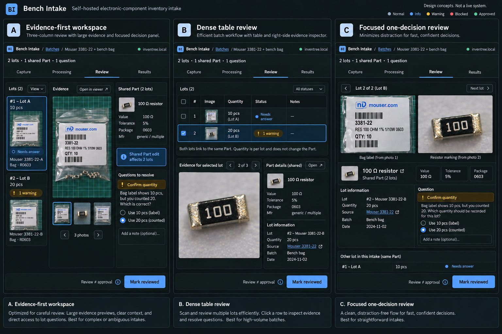

# 5. User experience

[Design index](README.md) · Wireframes are behavior specifications. Generated concepts are exploratory illustrations, not implementation or proof.

## Information architecture

```diagram
Home / Batches
  ├─ New batch / quick capture
  └─ Batch workspace
       ├─ Capture
       ├─ Processing: Overview | Reading | Identifying | Research | Images | Inventory
       ├─ Review: Evidence workspace | Table
       ├─ Approve: selected scope / exact effects
       └─ Results: rounds / lots / operations / recovery

Always available: activity + questions | target/runner status | settings/help
```

Use persistent URLs for batch, stage, selected lot, source page and approval round; returning from another device restores server-saved work, not local timer state. Global activity shows queued/running/waiting tasks across batches and links to the relevant item. Connection status distinguishes browser→application, application→target and runner→provider. “Connected” is not one green dot claiming all three.

## Primary original reference and layout exploration

Inspect the [original interactive HTML prototype](../../../../../docs/bench-intake/reference/bench-intake.html) and direct screenshots of [Inbox](../../../../../docs/bench-intake/reference/01-inbox.png), [Capture](../../../../../docs/bench-intake/reference/03-capture.png), [Review](../../../../../docs/bench-intake/reference/02-review.png), [phone frame](../../../../../docs/bench-intake/reference/10-phone.png) and [actual mobile viewport](../../../../../docs/bench-intake/reference/11-mobile-viewport.png) before changing layout. The [reference index](../../../../../docs/bench-intake/reference/README.md) preserves all fifteen original screenshots, provenance, dependencies and historical limitations. These originals are the primary visual/interaction reference; the generated board below is secondary and derivative. Current wireframes/contracts override obsolete prototype behavior and simulations.

During T02, Mitch explicitly approved the implementation's current light/neutral palette and blue accents, while requiring layout/UX continuity with the original. Preserve that palette; borrow the compact workspace hierarchy, retained evidence beside shared details, lot selection and narrow list → focused item flow. Do not switch to dark just to resemble screenshots, or introduce inactive capabilities as functional controls. Broader theme support remains a later product concern, not a reason to redesign this slice.



Recommended composition: **A** for evidence-heavy desktop review, **B** as the alternate bulk table, and **C's focused decision pattern** for narrow screens. They are complementary working modes, not three applications. Generated imagery/text is illustrative: the board omits some required navigation and contains fictional label details; the authoritative stage names, quantities, validation and behavior are the wireframes/contracts here. In particular, retain the separate **Approve** stage even where the concept artist omitted it. No concept button bypasses exact preparation and approval.

Preserve the existing prototype's restrained evidence-first direction: dark/light themes, blue selection, neutral surfaces, green confirmed outcomes, amber attention and red blocking. Use text/icons in addition to color. No chat-first shell; chat-like instructions can be one input, not the domain model. Keep high-density data readable rather than scaling a desktop canvas down on a phone.

## Home, setup and batches

Local operator setup configures the trusted InvenTree issuer/client, allowed owner, separate database/storage and fixed target; it does not create another password account or grant InvenTree permissions. On initial load, offer **Sign in with InvenTree**, then verify every required permission and delegated scope before fetching any workspace data. An authenticated underprivileged user sees a blocking page: **“Your InvenTree account does not have the permissions required to use Bench Intake.”** List safely identified missing capabilities, suggest contacting the InvenTree administrator, and offer retry/sign-out/account switch. If the check cannot complete, say **“Unable to verify access”** with retry rather than claiming permissions are missing. Do not show a partially working workspace behind either state.

Once access is qualified, capture/manual work can begin while provider setup is unresolved. Distinguish InvenTree application access from native provider sign-in/entitlement. Permission loss during use returns to the blocking access state, prevents new privileged work and preserves saved drafts/approvals/results; an in-flight inventory request may already have effects. The batch list shows title, last saved time, ready/needs-answer/blocked counts, active work and last approval outcome. Empty state offers **Take photos**, **Upload receipt**, **Describe components** and **Enter known values**. Search and filters operate over retained server state, not only mounted rows.

## Capture

```diagram
┌─────────────────────────────────────────────────────────────────────────┐
│ Bench Intake / Batch: Bench bag              Saved • target: workshop   │
│ Capture | Processing | Review | Approve | Results                       │
├──────────────────────────────────────┬──────────────────────────────────┤
│ Add photos / PDF / note / order ref   │ Shared details                   │
│ [Take photo] [Choose files] [Describe]│ Supplier     Purchase date       │
│                                      │ Location     Tags                │
│ packet-front.jpg  Retained ✓          │ Instructions                     │
│ receipt.pdf       Uploading 60%       │ [Save shared details]            │
│ back.jpg          Failed [Retry file] │ Applies to inherited fields only │
├──────────────────────────────────────┴──────────────────────────────────┤
│ Evidence group: order + bench bag [Edit links] [Add known lot]           │
│ 3 sources retained • 1 still local     [Process retained evidence]       │
└─────────────────────────────────────────────────────────────────────────┘
```

Each file has local/uploading/retained/failed state. A retained receipt includes server ID, hash/size and saved time, with details available without displaying long hashes everywhere. A page reload warns about unsent local files, not server-saved evidence. Retry is per file. Encrypted/unsupported PDFs offer instructions without blocking valid photos. Notes/order references work without attachments. Grouping evidence never silently creates/merges physical lots.

After identification, an evidence map supports correcting which regions/pages describe each lot, adding a missed lot and marking irrelevant evidence unused. Group instructions such as “same order, separate packets” remain visible to research. Do not promise OCR accuracy; expose raw observation and correction.

## Processing

```diagram
┌─────────────────────────────────────────────────────────────────────────┐
│ Processing: Overview | Reading | Identifying | Research | Images | ...  │
│ 2 running • 1 needs answer • 3 ready for review   [View activity]         │
├───────────────────────┬─────────────────────────┬───────────────────────┤
│ Job / subject         │ Current result / source │ Action                │
│ Reading receipt       │ 2 line observations ✓   │ Inspect / correct     │
│ Identify packet B     │ Count unknown           │ Answer count          │
│ Research shared Part  │ Resistor, 100 Ω, 5%      │ Sources / alternatives│
│ Match existing Part   │ 2 candidates            │ Compare candidates    │
└───────────────────────┴─────────────────────────┴───────────────────────┘
```

Each persistent stage view shows its job, actual attempt, source/result and available correction. Expanding a job reveals safe tool/source activity, not raw chain-of-thought, shell console or secret-bearing runtime streams. Show “waiting for sign-in”, “runner offline”, “subscription capacity” and “unsupported native PDF; extracted text used” distinctly. Retry/provider change creates an explicit attempt and preserves previous evidence. Cancelling research never implies a partially received result is current.

Question cards show the affected lots/fields, original source and why the answer matters. Validation is typed: count versus estimate, unit/range, choice among candidates or clarification. Save confirmation identifies which work will resume. An obsolete question displays “superseded” with current context rather than accepting an old response.

## Evidence workspace and table

The desktop workspace has a lot queue, large evidence viewer and decision panel. The viewer supports photo zoom/source-pixel regions, document pages and retained web excerpts. Fact rows show selected value, source, alternative/conflict, inherited/override/human status and edit control. Existing Part candidates compare identity differences; duplicate **stock** is a different issue from sharing an existing Part.

The table is a second projection of the same facts, with URL-persistent filters, explicit selection and an evidence inspector. Bulk actions preview exact selected IDs, affected shared Parts and excluded/blocked rows. A bulk review command either validates all named rows atomically or reports why it did not apply; it does not silently mark a subset reviewed. Independent bulk field edits may return per-row outcomes only if that partial policy was explicit in the confirmation.

Review rules:

- Required identity/count/target mapping conflicts block affected scope. A known unknown manufacturer need not block a supported spec-based Part; policy must say why it is acceptable.
- Warnings need resolution or a recorded reasoned dismissal. Cannot dismiss a blocking integrity/uncertainty issue into approval.
- “Mark reviewed” binds the dependency fingerprint, not a permanent boolean. Shared edits show “affects 2 lots” before saving and invalidate affected reviews.
- Exclude/defer preserves data/history and remains reversible for unapproved lots; it does not cancel a running approved command.
- On conflicting edits from another browser, preserve the local unsaved value and show current server value; offer explicit refresh/reapply with a new revision, never last-write-wins.

## Media workspace

```diagram
Original bytes ─► orientation-normalized source frame ─► recipe v3 ─► output
     │                       │                              │
     └──── immutable ────────┘                 preview + frozen derivative
                                                          │
                                             Part image OR lot attachment
```

Store raw originals and original EXIF metadata privately. Define crop coordinates in the orientation-normalized full-resolution image frame; normalize orientation first, crop, apply explicit quarter-turn rotation and encode using recorded settings/tool version. The preview uses the same affine transform. Store integer source-pixel bounds, validate inside decoded dimensions and retain chosen output bytes by hash; re-encoding is not guaranteed byte-identical across future tool upgrades.

Show original and derivative, crop/rotation handles, recipe version, destination and affected lots. Use arrow keys/numeric coordinates as an alternative to dragging. “Another version” creates a sibling recipe. Declining attachment is explicit. Documentary originals, enhanced images and generated illustrations have different labels; generated replacement of documentary evidence is not enabled in the first slice. A shared Part image edit invalidates all dependent reviews; a lot-only attachment affects that lot. Approved bytes cannot be silently regenerated.

## Approve

```diagram
┌─────────────────────────────────────────────────────────────────────────┐
│ Approve round 1             Target: Workshop • continuity checked        │
│ Selected: Lot A (10 pieces)  Remaining: Lot B (20 pieces)                 │
├─────────────────────────────────────────────┬───────────────────────────┤
│ Exact effects                               │ Review binding            │
│ REUSE category Resistors                     │ 1 selected lot reviewed   │
│ CREATE Part: 100 Ω, 5%  [shared prerequisite] │ 0 blocking issues         │
│ CREATE stock A: 10, Drawer 4, original key    │ 1 warning dismissed       │
│ ADD packet A attachment [preview bytes]      │ Plan ...6b3 / media ...f21 │
│ NOT INCLUDED: stock B / packet B             │ Prepared 2 minutes ago    │
├─────────────────────────────────────────────┴───────────────────────────┤
│ [Back to review]         [Approve these effects and queue application]   │
└─────────────────────────────────────────────────────────────────────────┘
```

Preparation can discover a new choice and return to review. Display creates/reuses/permitted missing-field additions/attachments grouped by target with shared effects once. No ambiguous generic “Import all” button. A stale plan cannot be approved; refreshing shows an effects diff and requires review again if relevant values changed. Once approval is saved, display its immutable round and queued command; duplicate clicks adopt the same command, not another round.

## Results and recovery

```diagram
Round 1 • stock registered, supporting work incomplete
  Lot A       stock #421 confirmed   barcode confirmed
    packet photo         confirmed
    supporting document  failed before effect   [Inspect supported repair]
  Shared Part #93        confirmed
  Lot B                  not selected, still in Review

Unknown stock request → “May have been created; do not create again”
                       [Inspect evidence / supported reconciliation]
```

Show cumulative lot outcomes and per-round immutable history, with operation/request details on demand. Links to target records are built from the configured target and validated IDs, not arbitrary provider URLs. A lost connection shows “status unavailable” until snapshot reconciliation, not “failed import”. Cancellation explains what is confirmed/unknown and what was not started. Only server-advertised recovery actions appear; no generic retry of an entire lot.

## Phone and accessibility

```diagram
┌─────────────────────────────┐
│ Batch / 2 lots     Activity  │
│ Capture Processing Review…  │
├─────────────────────────────┤
│ Lot B • 1 of 2              │
│ [large source image]        │
│ Count: 20  Human counted    │
│ Label: approx.20  Observed  │
│ [See alternatives]          │
│ Question / warning details  │
│ [Previous] [Mark reviewed]  │
└─────────────────────────────┘
```

On narrow screens, use a single-column detail with source/details switching and a compact lot picker. Tables scroll within a labeled region or offer cards; the page itself must not horizontally overflow. Maintain all five primary views, using accessible overflow/navigation rather than removing Approve. Sticky action bars respect safe areas and the on-screen keyboard. Phone capture defaults to device camera where supported, with ordinary file selection available.

Target WCAG 2.2 AA: keyboard navigation, visible focus, semantic headings/tabs/forms/tables, error summaries tied to fields, contrast in both themes, reduced-motion support, screen-reader status announcements without token spam and touch targets of at least 44 CSS pixels where practical. Dialogs trap/restore focus. Zoom at 200%, true 360/390 CSS-pixel viewports and long filenames/translated-length text must be tested. Never reuse global CSS names that collided in the prototype.

## Settings and operator experience

| Setting                               | User behavior / invalidation                                                                                                                                                                                                                             |
| ------------------------------------- | -------------------------------------------------------------------------------------------------------------------------------------------------------------------------------------------------------------------------------------------------------- |
| Target/identity/access                | Server-private delegated credentials, current user/requirements status and safe missing capabilities; no browser token field or privileged-account bypass. Read-only qualification; target changes invalidate preparations and cannot rebind active runs |
| Category/parameter mappings and units | Versioned configuration; show affected fields/reviews; new preparation required                                                                                                                                                                          |
| Provider/runner/tool instructions     | Capabilities and observed/tested status; changes start new attempts, not rewrite old results                                                                                                                                                             |
| Defaults                              | Future/inherited draft values only; reviewed/approved history preserved                                                                                                                                                                                  |
| Storage/retention                     | Usage, backup health, pinned recovery data, explicit archive/delete semantics                                                                                                                                                                            |
| Diagnostics                           | Outbox conflicts, incompatible versions, stalled processes, missing blobs, restore gate; supported actions, not raw SQL repair                                                                                                                           |

Prototype/history pitfalls become tests: originals survive preview disposal; shared-image edits invalidate all affected reviews; old rounds are not overwritten; no localStorage success timer; keyboard/theme/device controls do not collide with app CSS; true mobile layout is tested, not a scaled desktop frame.
